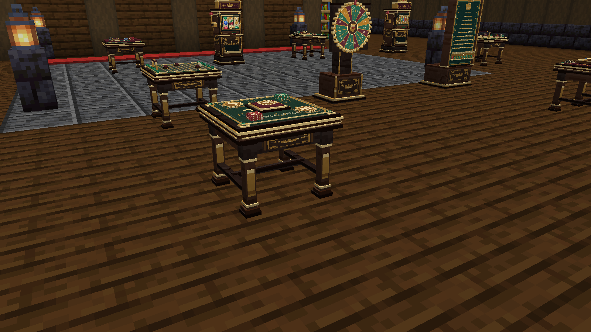

## Before you play

Realm Casino uses the **Origins digital wallet** for virtual stakes. Install compatible versions on the server and clients, including Origins' own required dependencies.

Each game has a physical block with its own menu. Read the shown rules, stake, and possible outcomes before confirming a bet.

## The twelve games

The collection includes three-reel and five-reel slots, European roulette, blackjack against the house, Plinko, Wheel of Fortune, Royal Crossing, miniature horse races, Texas Hold'em, multiplayer twenty-one, dice, and coin flip.

The games have different mechanics. For example, multiplayer card tables use their own seat and private-card rules, while horse races animate miniature horses on the physical track.

*Actual game blocks in a demonstration Minecraft casino.*

## For players

Interact with the relevant game block, follow its seating or joining flow where applicable, and review the stake. Follow the game's controls through completion, then use its supported payout or collection action.

Consult the [complete game rules and odds](https://github.com/ROCKABITS/Mods/blob/main/realm-casino/README.md#regras-e-probabilidades) before choosing a game. There is no single shared probability table for every machine.

## For casino owners

Owners manage a funded bankroll at their game blocks. Depositing capital, funding play, and withdrawing profit are distinct operations.

With compatible Realm Treasury installed, the configured tax applies to **withdrawn owner profit after deposited capital is recovered**. It is not an automatic tax on every displayed stake.

## Multiplayer tables

Poker and other supported multiplayer tables use funded stakes and server-managed results. Private cards belong to their player; do not assume another participant's interface exposes the same information.

See the [source guide](https://github.com/ROCKABITS/Mods/blob/main/realm-casino/README.md) for recipes, each game's exact controls, bankroll recovery, persistent data, and update compatibility.
