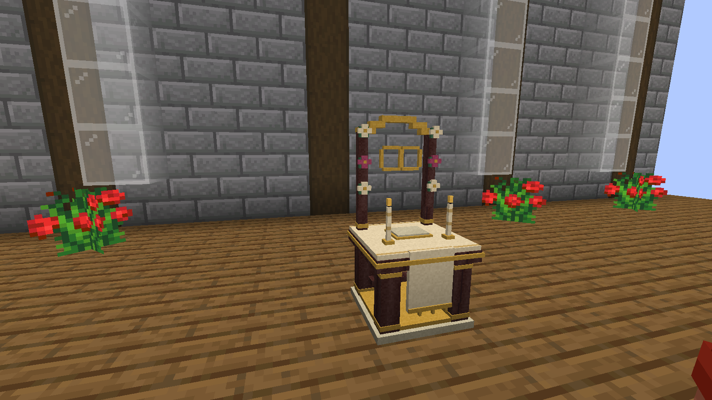

## Get engaged

Craft an **Engagement Ring** and use it on the other player. They can accept or reject the proposal, and either partner can cancel an engagement later.

Place a **Wedding Altar** on solid ground with two free blocks of height. You build the venue yourself; the mod does not generate a church.

## Agree on the ceremony

At the altar, choose the celebrant, up to two witnesses, the financial arrangement, and the divorce split. Read any announced fee.

**Both partners must approve exactly the same agreement.** The celebrant and witnesses also accept their invitations. Any player can be a celebrant; they do not need a special government role.

## Exchange vows

1. Gather the participants at the altar.
2. The celebrant opens the ceremony and introduces the couple.
3. During the server-timed **10-second objection window**, guests may press **G**. This binding can be changed in Minecraft's controls.
4. An objection pauses proceedings for a written explanation and discussion. Both partners must confirm before continuing; either may withdraw.
5. The celebrant asks each partner for their vow. The selected witnesses sign before the union is sealed and payment is confirmed.
6. Collect the wedding ring and certificate at the altar. Leave **two inventory slots** free.

## Finances and shared accounts

The agreement offers three financial arrangements:

| Arrangement | What happens |
| --- | --- |
| Joint money | Consolidates both wallet balances into a common account after the agreed fee. New personal income can later be consolidated at the altar. |
| Separate money | Keeps personal wallets separate, charging only the agreed fee when applicable. There is no common balance. |
| Joint account | Keeps personal wallets and starts an empty common account that both partners can fund and withdraw from. |

Read the terms in the altar before either partner approves. Financial arrangements use the Origins wallet. Without Origins, a free ceremony with separate money is supported. A ceremony needs three distinct players: two partners and a celebrant; witnesses are optional.

Other mods continue to use personal wallets unless they implement that shared-account API. Marriage does not silently redirect every purchase into a joint account.

## Certificates and divorce

Realm Identity can show civil status and verify a marriage certificate. The ring also opens a personal consultation, where cancellation or divorce can be requested. Divorce settles the shared balance under the recorded agreement and retains credits owed to offline players.

Read the [complete guide](https://github.com/ROCKABITS/Mods/blob/main/realm-marriage/README.md) for recipes, the three arrangements, and configuration.
