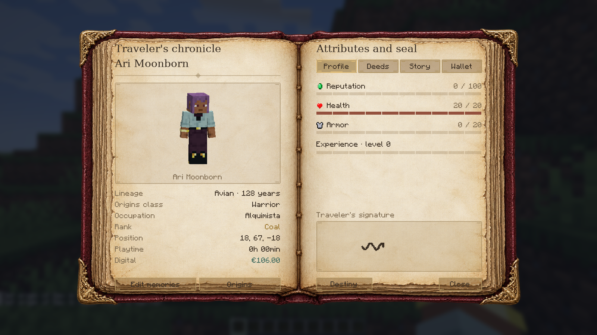

## Prepare your instance

Install Realm Origins 0.5.7 with **Origins 0.3.2** and **Jupiter 2.3.7** for NeoForge. Origins: Classes 0.3 is optional. See [installation](/wiki/installation/) for the client and server requirements.

Realm Origins replaces Chronicles RP. Keep the new JAR in place of the old one so your existing profiles and wallet remain part of the same system.

## Create a character

Follow the chapter-based creation screen to enter your character's details. You can see the character's skin in a 3D portrait while you work.

*Reference screenshot from the real Minecraft client. Character details are demonstration data.*

Choose your roleplay name, fill in the identity fields, write your occupation and history, then draw your signature. Occupations accept **one word of up to 24 characters**, including accents and hyphens. The quick suggestions fill the field for you.

Read the final review before confirming. Existing saved money is shown without awarding a second starting balance.

## Open your character book

Press **P** after creation to open the parchment book. It brings together your character sheet, deeds, history, and wallet. Currency exchange also uses this book.

The creation screens and the in-world book intentionally have different presentations: creation uses the dark chapter-based interface, while everyday reference uses parchment pages.

## Your public name

Your roleplay name appears above your character, in TAB, and as the displayed author in normal chat. Other players receive the public name, not your private history, signature, or wallet balance.

Your real Minecraft account identity still exists underneath. Use the **actual account username** in administration and commands that ask for a player. Roleplay names can repeat, so a displayed RP name is not a unique account identifier.

## Build on your character

[Identity](/wiki/realm-identity/) can issue a physical document from the profile. [Markets](/wiki/realm-markets/), [Treasury](/wiki/realm-treasury/), and other supported mods can use the wallet.

For editing behaviour, compatibility details, and the complete version notes, see the [source guide](https://github.com/ROCKABITS/Mods/blob/main/realm-origins/README.md).
