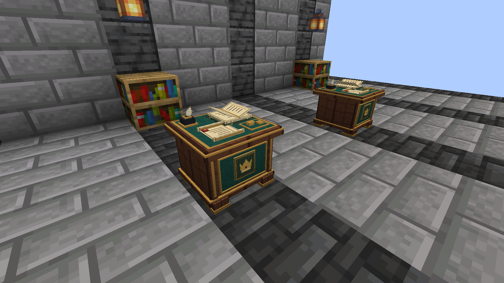

## Open the public treasury

Realm Treasury 0.4.0 replaces **Crown Ledger**. Install the new JAR in place of the old one on the server and clients.

Craft and interact with the **Crown Chest**. Chests across dimensions access the same server treasury. Breaking a chest does not erase the kingdom's funds or public history.

With Realm Council, financial management belongs to the current elected and sworn ruler. Without Council, an operator can appoint a steward with `/crown steward AccountUsername`.

## Public money

The treasury tracks available money, reservations, configured taxes, salaries, and public funding. Reserved money cannot be spent again on another commitment.

Supported companion mods can deliver market tax, judicial payments, contract tax, and other configured revenue. A feature's own guide explains when and how that payment occurs.

## Read a proposal and vote

When a public vote is announced, press **F8** to open the ballot. This key can be changed in the controls. Read the full title and description before voting.

A free-form proposal is advisory; approving it does not automatically alter the world. Funded benefits additionally require approval and reserved treasury money. F8 provides public voting access without giving remote spending powers.

## Apply for a loan

*The physical Loan Counter in a reference Minecraft scene.*

1. Interact with a **Loan Counter**, choose a new request, and enter the amount and purpose.
2. The authorised ruler reviews it and proposes fixed interest, instalments, and real-day intervals within administrative limits.
3. Reserving the proposal sets aside the capital. You have not received the money yet.
4. Read the contract and sign to receive the capital. The repayment timetable starts at signing.
5. Return to a counter to pay an instalment or settle the remaining balance manually.

For example, 100 € at fixed 10% interest over five instalments gives a total debt of 110 € and five payments of 22 €. Paying early keeps the agreed total interest. The timetable includes offline time, but payments are manual.

## Before an update

Version 0.4.0 migrates treasury data to format 9. Back up the complete world and Origins profiles together; a downgrade requires restoring the earlier backup.

Read the [full treasury guide](https://github.com/ROCKABITS/Mods/blob/main/crown-ledger/README.md) for eligibility, deadlines, administrative limits, salaries, and financial records.
